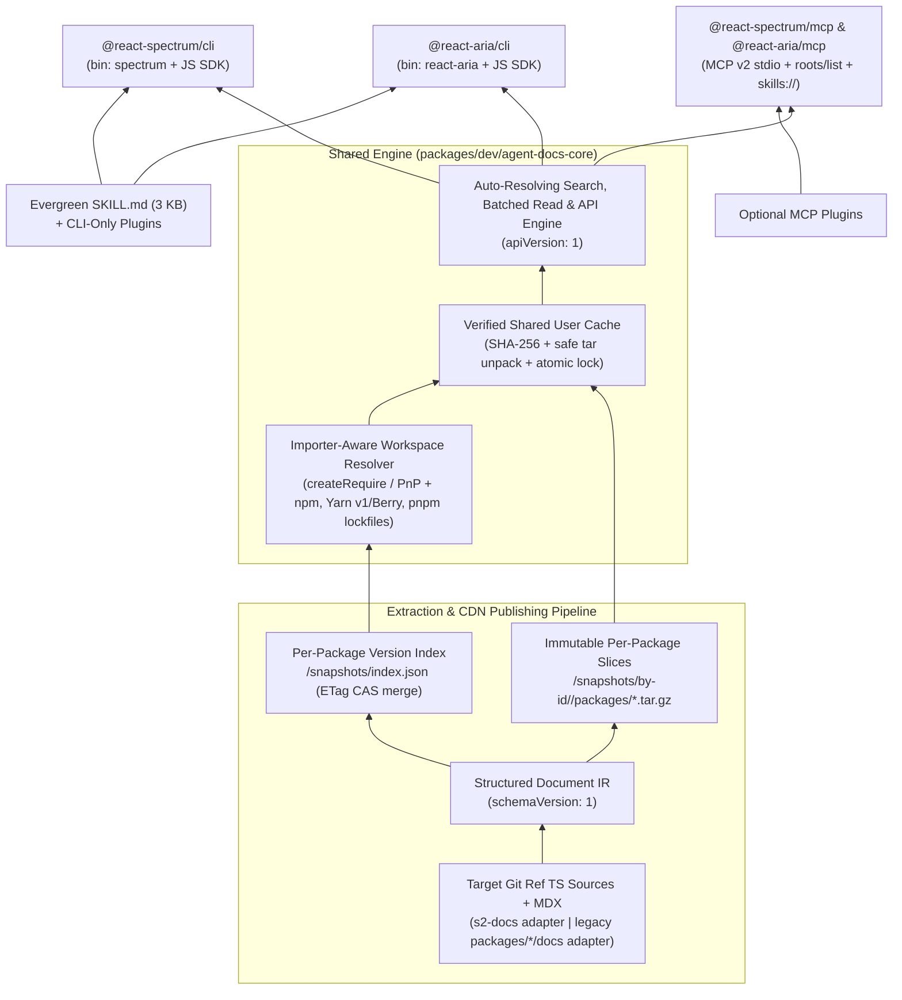

# RFC: Version-Aware Agent Documentation, CLIs, MCP v2, and Evergreen Skills

- **Status:** Implemented (Draft for Review)
- **Packages:** `@react-spectrum/cli`, `@react-aria/cli`, `@react-spectrum/mcp`, `@react-aria/mcp`, `packages/dev/agent-docs-core`, `packages/dev/agent-docs-bench`
- **Standards:** [Agent Skills](https://agentskills.io/specification), [Agent Plugins 1.0](https://agent-plugins.org/specification), [MCP 2026-07-28](https://modelcontextprotocol.io/specification/2026-07-28) & Skills Extension (`SEP-2640`)

---

## 1. Summary

This RFC introduces a unified, version-aware documentation and API retrieval architecture for coding agents building interfaces with **React Spectrum S2** (`@react-spectrum/s2`) and **React Aria** (`react-aria-components`, `react-aria`, `react-stately`, `@internationalized/*`).

Instead of bundling hundreds of static Markdown files into user repositories or serving unversioned pages one tool call at a time over MCP, we publish **immutable, per-package documentation slices** to a CDN and query them through one shared TypeScript engine (`agent-docs-core`). That engine powers:

1. **Two new CLIs with programmatic SDKs:** `@react-spectrum/cli` (`spectrum`) and `@react-aria/cli` (`react-aria`).
2. **Two MCP server wrappers:** `@react-spectrum/mcp` and `@react-aria/mcp`.
3. **A small version-neutral `SKILL.md`** and **four separated Agent Plugin bundles** (CLI-only vs. MCP-enabled).

**Primary goal:** *One lookup gives a coding agent the exact imports, composition examples, styling rules, and TypeScript APIs supported by the consumer workspace's resolved dependencies.*

---

## 2. Motivation & Problem Statement

Our first-generation AI/agent integrations suffered from some key limitations:

1. **Manual update churn in Agent Skills:** Static skills froze documentation at install time, and upgrading `@react-spectrum/s2` or `react-aria-components` silently left agents reading outdated or mismatched references unless developers manually reinstalled skills.
2. **Repository bloat:** Project-scoped static skill installation wrote `267` files (`~4 MB`) into the user's repository.
3. **No historical version support:** Neither static skills nor v1 MCP servers could serve documentation for projects pinned to earlier `1.x` releases—causing agents to hallucinate components (e.g., `SideNav`, `Autocomplete`) or props (`prefix`, `selectionMode`) added in newer versions.
4. **Independent multi-package version skew:** React Spectrum and React Aria do not share a single ecosystem version. A workspace may combine `@react-spectrum/s2@1.2.0` with a newer direct `react-aria-components@1.22.1` dependency—a version tuple that never existed in any single monorepo git tag, and where S2's internal RAC version differs from the application's direct RAC version.
5. **High-latency, high-token MCP waterfalls:** v1 MCP servers (`list_*_pages` → `get_*_page_info` → `get_*_page`) fetched one full page per tool call (`4.1` average lookups and `~16.8k` tokens per task).
6. **Activation friction:** MCP servers required explicit per-client configuration and spawned persistent `stdio` processes even in CLI-capable coding agents (Claude Code, GitHub Copilot CLI, Codex) that already have shell execution.

---

## 3. Goals & Non-Goals

### Goals
- **Automatic per-package version resolution:** Resolve exact installed or lockfile-pinned versions from the consumer workspace (including Yarn PnP and monorepo sub-workspaces) without requiring agents to pass `--version` on normal calls.
- **Visibility into versions served:** Never serve `latest` or an unverified minor snapshot as if it matched an unsupported historical patch release.
- **1–2 lookup task completion:** Complete known-component lookups in **1 call** (batched `read`) and discovery + implementation lookups in **2 calls** (`search` → batched `read`).
- **Tiny, evergreen repository footprint:** Keep installed skills to a single `SKILL.md` free of version-sensitive API or import rules.
- **Shared implementation across CLI, SDK, and MCP:** Ensure identical resolution, provenance, search ranking, and partial-batch semantics across terminal and tool-only environments.
- **Safe concurrent CDN publishing & local caching:** Prevent CDN cache-header clobbering, race conditions between release and backfill jobs, and archive extraction vulnerabilities.

### Non-Goals
- **Legacy React Spectrum v3 (`@adobe/react-spectrum`) catalog coverage:** Initial implementation targets S2, RAC, hooks, stately, and `@internationalized/*`.
- **Hosted remote (`streamable-http`) MCP service:** Initial implementation ships local `stdio` MCP servers backed by the shared CDN snapshot cache; the stateless `resolution` parameter prepares the contract for future hosted deployments.
- **AST-based code generation, scaffolding, or codemod execution inside the docs CLI:** Deferred, but can be revisited later.

---

## 4. Detailed Design

### 4.1 Architecture Overview & Five Versioned Surfaces



To eliminate coupled upgrades, five surfaces are versioned independently:

| Surface | Identifier | Responsibility & Compatibility Policy |
| :--- | :--- | :--- |
| **1. Library packages** | SemVer per package + importer | Defines the actual runtime components, hooks, props, and tokens installed in the consumer's workspace. |
| **2. Documentation snapshot** | `snapshotId` (`YYYYMMDD-g<sha>-d<rev>`) | Immutable build artifact recording `sourceTag`, `sourceCommit`, `extractorCommit`, `docRevision`, and slice SHA-256 digests. Incrementing `docRevision` fixes prose/examples for an existing package release without mutating prior objects. |
| **3. Catalog schema** | `schemaVersion` & `minReaderSchemaVersion` | Governs the serialized Document IR (`1` initially). Additive fields keep `minReaderSchemaVersion` unchanged; breaking IR changes increment both while older readers fail fast with `ERR_CATALOG_SCHEMA_TOO_NEW` instead of misparsing. |
| **4. Query contract** | `apiVersion: 1` | Governs CLI `--json` envelopes, deterministic exit codes, SDK TypeScript types, and MCP v2 tool schemas. |
| **5. Evergreen `SKILL.md`** | Skill workflow revision | Teaches discovery/lookup workflow and tool fallbacks; contains zero hardcoded component props, subpath rules, or token lists. |

---

### 4.2 Per-Package Snapshot Slices vs. Resolved Documentation Set

A central design distinction separates **how documentation is built** from **how a consumer project resolves it**:

- **Published Snapshot (`/snapshots/by-id/<snapshotId>/`):** Produced from a git commit or release tag and split into **per-package `.tar.gz` slices** (`packages/react-spectrum__s2.tar.gz`, `packages/react-aria-components.tar.gz`, `packages/internationalized__date.tar.gz`, etc.) plus `manifest.json`.
- **Per-Package Index (`/snapshots/index.json`):** Maps `packages[packageName][exactVersion]` → `PackageSlicePointer` (`snapshotId`, `docRevision`, `sliceRelPath`, `sliceSha256`, `sliceBytes`, `schemaVersion`, `minReaderSchemaVersion`, `verifiedEquivalentPatches`).
- **Resolved Documentation Set:** Assembled dynamically per workspace by resolving each documented package independently:
  - If an app depends on `@react-spectrum/s2@1.2.0` and `react-aria-components@1.22.1`, `s2:*` queries read from the `1.2.0` S2 slice while `rac:*` queries read from the `1.22.1` RAC slice.
  - Every result carries entry-level `provenance` (`packageName`, `packageVersion`, `snapshotId`, `exactMatch`) plus a top-level `snapshots` map summarizing all referenced snapshots.

#### Importer Context & Divergent Transitive Instances
Because `@react-spectrum/s2` depends on `react-aria-components` internally, a workspace can contain **two different installed versions of `react-aria-components`**. The resolver runs two resolution passes:
1. Anchor `createRequire` at `<workspaceDir>/package.json` to resolve the workspace's direct dependencies (`importer: "workspace"`).
2. Anchor a second `createRequire` at the resolved `@react-spectrum/s2/package.json` path to inspect S2's nested resolution (`importer: "@react-spectrum/s2"`).

When both exist and diverge, the SDK resolves direct `rac:*` queries against the workspace's direct RAC version and emits a structured `WARN_MULTIPLE_PACKAGE_INSTANCES` diagnostic detailing both versions.

---

### 4.3 Shared Document IR (`schemaVersion: 1`) & Out-of-Tree Historical Extraction

#### Rich Structured Document IR
`packages/dev/s2-docs/scripts/lib/snapshotExtractor.mjs` parses MDX and TypeScript declarations (`ts-morph`) into a single structured IR per entry before rendering deterministic Markdown (`.md`), JSON (`entries.json`), S2 asset catalogs (`s2-assets.json`), and weighted search terms (`search-index.json`):

- **Explicit library & package identity:** Every entry ID is prefixed (`s2:ComboBox`, `rac:ComboBox`, `rac:useComboBox`, `internationalized:CalendarDate`) and includes canonical import statements (e.g., subpath `@react-spectrum/s2/ComboBox` vs. `react-aria-components`).
- **Categorized TypeScript API representation:** Preserves `typeParameters` (generics, constraints, defaults), `props`, `events`, `renderProps`, `slots`, `callSignatures` / `overloads`, and `inheritedFrom` provenance rather than flattening everything into an undifferentiated table.
- **Section-addressable prose:** Normalizes pages into `summary`, `usage`, `api`, `accessibility`, `styling`, and `testing` sections so agents can request compact slices (`--sections usage,api`) and follow `continueCommand` pointers when token budgets truncate output.
- **Cataloged implementation, migration & audit guides:** Version-sensitive implementation guidance (`s2:implementation-guidance`, `s2:component-decision-tree`, `s2:style-macro`, `s2:creating-custom-components`, `s2:figma-to-s2`, `s2:testing`, `s2:migration-*`, `rac:testing`) lives inside each versioned slice so rules like S2 subpath imports or `label` prop vs. `<Label>` composition always match the target package version.

#### Historical Backfill & Strict Patch Semantics
Older tags in `react-spectrum` span two distinct documentation architectures:
- **`s2-docs` MDX layout** (`@react-spectrum/s2@1.0.0+` and newer RAC releases).
- **Pre-`s2-docs` legacy `packages/*/docs/*.mdx` layout** (e.g., `react-aria-components@1.0.0–1.10.x`, which predates both `s2-docs` and `generateMarkdownDocs.mjs`).

`backfillSnapshots.mjs` checks out historical git tags into isolated temporary detached worktrees (`git worktree add --detach`) while executing the **current `HEAD` extractor** out-of-tree with layout auto-detection (`s2-docs` vs. `legacy-mdx`).

**Strict patch-release policy:** A minor release snapshot (e.g., `1.2.0`) is **never** silently advertised as an exact match for `1.2.1`. During backfill, `backfillSnapshots.mjs` hashes exported TypeScript declarations across patch tags:
- If `1.2.2` has an identical public API surface digest to `1.2.0`, `1.2.2` is recorded in `verifiedEquivalentPatches` and resolves cleanly with `matchedVia: "verifiedEquivalentPatch"`.
- Otherwise, `1.2.1` resolves nearest available fallback documentation with `exactMatch: false` and emits an explicit `EXACT_PATCH_UNAVAILABLE` warning listing nearest available versions.

---

### 4.4 Workspace & Lockfile Resolution (CLI, SDK & MCP)

#### CLI & SDK Resolution Order (`packages/dev/agent-docs-core/src/resolver.ts`)
1. **Explicit overrides win:** `--snapshot <snapshotId>` or `--version <pkg@ver | ver | latest>` (`repeatable`).
2. **Workspace-anchored installed resolution:** Walks up from `--cwd` (default `process.cwd()`) to the nearest `package.json` and resolves candidate packages via Node's `createRequire(path.join(workspaceDir, 'package.json'))`. This natively supports standard `node_modules`, hoisted monorepos, pnpm symlinks, and active **Yarn Plug'n'Play (`.pnp.cjs`)** loaders without hardcoding `node_modules` paths.
3. **Bounded workspace-aware lockfile fallback (`lockfiles.ts`):** When dependencies are not yet installed on disk (or when cross-checking installed versions against lockfiles to emit `WARN_LOCKFILE_MISMATCH`), parses:
   - `package-lock.json` / `npm-shrinkwrap.json` (v2/v3 workspace `packages[...]` entries)
   - `pnpm-lock.yaml` (v6–v9 monorepo `importers[<workspaceRelPath>]` blocks—strictly scoped to the target workspace importer rather than naive whole-file regexes)
   - `yarn.lock` (Classic v1 and Berry v2–v4 matched against the workspace's declared specifiers)
   - Unsupported lockfiles (`bun.lock`, `bun.lockb`) fail explicitly with `ERR_UNSUPPORTED_LOCKFILE` and actionable remediation (`install dependencies or pass --version`) rather than guessing.

   The nearest lockfile wins. A lockfile in an ancestor directory is only used when it covers the workspace (an npm `packages` entry, a pnpm importer, or a Yarn/Bun root `package.json` that declares `workspaces`); otherwise it's treated as belonging to an unrelated project and ignored.
4. **Outside a project:** Running outside any `package.json` workspace without `--version` fails explicitly (`ERR_WORKSPACE_REQUIRED`) rather than silently defaulting to `latest`.

#### Explicit MCP Workspace Discovery (`packages/dev/mcp/shared/src/server.ts`)
Because `stdio` MCP servers are frequently launched by GUI hosts with an arbitrary working directory (such as `/`), MCP tools resolve workspace context deterministically:
1. Reusable `resolution` object returned by a prior `resolve_versions` call.
2. Explicit `cwd` argument passed to the tool call.
3. `--cwd` CLI flag passed when starting the MCP server.
4. **MCP client `roots/list` capability** (automatically invalidated on `notifications/roots/list_changed`): selects the unique root containing Spectrum/Aria dependencies, or returns `ERR_AMBIGUOUS_WORKSPACE_ROOTS` listing discovered roots when multiple workspaces match so the agent passes `cwd`.
5. `process.cwd()` fallback only if it lies inside a valid `package.json` workspace.

---

### 4.5 CLI, SDK & MCP v2 Contracts (`apiVersion: 1`)

#### Brand CLIs (`@react-spectrum/cli` & `@react-aria/cli`)
`search`, `read`, `api`, `tokens`, and `icons` auto-resolve workspace dependencies on every call; standalone `resolve` is purely diagnostic.

```sh
# React Spectrum S2 + React Aria (@react-spectrum/cli -> `spectrum`)
spectrum search "searchable dropdown" [--library s2|rac|all] [--cwd apps/web] [--json]
spectrum read s2:ComboBox s2:Popover [--sections usage,api,accessibility,styling,testing,guide] [--max-tokens 4000] [--json]
spectrum api s2:ComboBox [--export ComboBox] [--prop selectedKey,onSelectionChange] [--events-only] [--render-props] [--json]
spectrum tokens [query] [--property backgroundColor] [--json]
spectrum icons Edit Delete [--illustrations] [--json]
spectrum resolve [--cwd apps/web] [--json]
spectrum prefetch [--cwd apps/web] [--version @react-spectrum/s2@1.8.2] [--json]
spectrum manifest --json

# React Aria Components, Hooks, Stately & Internationalized (@react-aria/cli -> `react-aria`)
react-aria search "date range" [--json]
react-aria read rac:DateRangePicker internationalized:CalendarDate [--json]
react-aria api rac:ComboBox --render-props [--json]
```

**Deterministic CLI behavior:**
- **Default output:** Compact, clean Markdown with zero ANSI spinners or decorative chrome when piped.
- **Structured output (`--json`):** Versioned `apiVersion: 1` JSON envelope with `snapshots`, `resolution`, `warnings`, and per-entry `results`.
- **Partial-batch resilience:** In `read A B C`, if `B` is unknown (`ERR_ENTRY_NOT_FOUND` with fuzzy `suggestions`), `A` and `C` are still returned (`partial: true`, exit code `0`); exit code `3` (`NOT_FOUND`) is returned only when **every** requested ID fails.
- **Predictable exit codes:** `0` (`OK`), `1` (`INTERNAL_ERROR`, unexpected failures), `2` (`INVALID_ARGS`), `3` (`NOT_FOUND`), `4` (`OFFLINE_OR_NETWORK`), `5` (`INTEGRITY_OR_SCHEMA`).

#### Clean-Cutover MCP v2 (`@react-spectrum/mcp` & `@react-aria/mcp`)
Per MCP's runtime tool discovery model (`tools/list`), legacy v1 `list_*_pages`, `get_*_page_info`, and `get_*_page` tools are removed cleanly in favor of batched version-aware v2 tools wrapping `agent-docs-core` in-process:

| Tool / Resource | Surface | Purpose |
| :--- | :--- | :--- |
| `resolve_versions` | Both | Inspects workspace dependencies (`cwd` or `roots/list`) and returns a reusable `resolution` state object + warnings. |
| `search_docs` | Both | Ranked multi-package search across components, guides, hooks, and utilities. |
| `read_docs` | Both | Batched multi-ID read (`ids`, `sections`, `maxTokens`, `cwd`, `resolution`, `version`, `snapshot`) with partial-batch resilience. |
| `get_component_api` | Both | Focused TypeScript API lookup (`id`, `exportName`, `propFilter`, `eventsOnly`, `renderPropsOnly`). |
| `search_s2_tokens` | `@react-spectrum/mcp` | Version-matched Spectrum 2 `style` macro property and design token lookup. |
| `search_s2_icons` | `@react-spectrum/mcp` | Version-matched Spectrum 2 workflow icon and illustration search (including synonym aliases). |
| `skills://<skill>/SKILL.md` | Both | `SEP-2640` evergreen skill Markdown resource (`skills://react-spectrum-s2/SKILL.md`, `skills://react-aria/SKILL.md`). |

---

### 4.6 Evergreen `SKILL.md` & Separated Agent Plugin Bundles

`packages/dev/s2-docs/scripts/generateAgentSkills.mjs` and `scripts/generateAgentPlugins.mjs` (`yarn generate:plugins`) generate:
1. **Single-file evergreen `SKILL.md` (`~3 KB`)** for `.well-known/agent-skills/` and plugin distribution—containing zero version-sensitive prop lists or import paths, instructing agents to run 1–2 batched lookups and obey the returned versioned guidance.
2. **Four separated Agent Plugin bundles under `plugins/`** (supporting both portable Agent Plugins 1.0 `plugin.json` and `.claude-plugin/plugin.json` + `plugins/marketplace.json`):
   - **`plugins/react-spectrum` & `plugins/react-aria` (Recommended default):** Skill-only bundles with **no `mcp.json`**, ensuring CLI-capable hosts never spawn idle background `stdio` MCP processes or pay duplicate tool-schema context overhead.
   - **`plugins/react-spectrum-mcp` & `plugins/react-aria-mcp`:** Optional MCP-enabled bundles (`.mcp.json` at plugin root; `.claude-plugin/plugin.json` omits `mcpServers` to prevent duplicate server registration in hosts that read both manifests).

`validateGeneratedPlugins()` enforces frontmatter constraints, bans version-sensitive leaks in `SKILL.md`, and verifies zero duplicate MCP definitions across manifests.

---

### 4.7 Hardened 3-Step S3 Publishing & Verified Local Cache

#### CDN / S3 Publication (`publishSnapshots.mjs` & `.circleci/config.yml`)
1. **CircleCI live-site isolation:** Added `--exclude "snapshots/*"` to all four general `aws s3 cp` sync passes in `.circleci/config.yml` so short-TTL live-site deploys (`max-age=300`) never clobber immutable snapshot objects or `snapshots/index.json`.
2. **Step 1 — Upload immutable objects:** Uploads `/snapshots/by-id/<snapshotId>/*` with `Cache-Control: public,max-age=31536000,immutable` (`--if-none-match "*"` / content-verified skip on idempotent reruns).
3. **Step 2 — Pre-pointer completeness & SHA-256 check:** Verifies via `HeadObject` that every manifest-referenced slice exists remotely with exact byte length and SHA-256 digest before touching `index.json`.
4. **Step 3 — Conditional `If-Match` CAS loop on `snapshots/index.json`:** Reads current `index.json` + `ETag`, merges new snapshot and package pointers (preserving monotonic SemVer `latest` pointers even when publishing older backfills and unioning `verifiedEquivalentPatches`), and writes back with `--if-match <ETag>` (`--if-none-match "*"` on bootstrap) with bounded backoff retries on `PreconditionFailed`.

#### Shared User Cache (`packages/dev/agent-docs-core/src/cache.ts`)
- Stores unpacked slices under the OS user cache (`~/.cache/react-spectrum-agent-docs`, `~/Library/Caches/...`, or `%LOCALAPPDATA%`), keeping consumer repositories completely clean.
- Verifies downloaded `.tar.gz` SHA-256 and byte length against `index.json` **before** decompression.
- Uses a custom zero-dependency tar unpacker (`tarArchive.mjs` / `cache.ts`) that rejects `..` path traversal, absolute paths, symlinks/hardlinks, device/FIFO entries, and oversized archives (`ERR_ARCHIVE_SECURITY`).
- Coordinates concurrent CLI/MCP processes via per-slice lockfiles + staging temp directories + atomic `fs.renameSync`.
- Supports `prefetch` + `--offline` (`ERR_OFFLINE_CACHE_MISS`) for deterministic, air-gapped CI environments.

---

## 5. Security & Reliability Considerations

- **Archive & Supply-Chain Integrity:** Every slice pointer in `index.json` embeds `sliceSha256` and `sliceBytes`. Any corrupted or tampered archive fails closed (`ERR_INTEGRITY_MISMATCH`, exit code `5`) prior to extraction, and custom tar validation blocks zip-slip and symlink escape attacks.
- **Concurrent Process & CI Safety:** Both local cache extraction (lockfile + atomic rename) and remote S3 index updates (`If-Match` ETag compare-and-swap) are concurrency-safe and covered by automated fault-injection tests.
- **Untrusted Workspace Inputs:** Lockfile parsers operate as pure bounded text/JSON readers without executing workspace scripts or arbitrary code.

---

## 6. Evaluation & Benchmark Results

`packages/dev/agent-docs-bench` (`yarn bench:agent-docs compare --include-mcp`) evaluates standard S2/RAC component tasks alongside four version-trap fixtures (`pinned-s2-1.2.0`, `pinned-rac-1.4.0`, `mixed-s2-1.2.0-rac-head`, and `unverified-patch-s2-1.2.1`) across the legacy static skill, legacy v1 MCP waterfall, and the new v2 system:

| Metric | Legacy Static Skill | Legacy v1 MCP | **Agent Docs v2 (New)** |
| :--- | :---: | :---: | :---: |
| **Project files installed** | `267` (`3,996 KB`) | `0` | **`1` (`3 KB`)** |
| **Average lookups per task** | `2.6` (max `5`) | `4.1` (max `9`) | **`1.1` (max `2`)** |
| **Average doc tokens per task** | `11,847` | `16,799` | **`4,876` (`-59%` vs. skill, `-71%` vs. MCP)** |
| **Version-trap fixtures passed** | `0 / 4` | `0 / 4` | **`4 / 4` (zero wrong-version leaks)** |
| **SDK warm query latency (median)** | — | — | **`21.5 ms`** (`61.4 ms` cold unpack) |
| **CLI direct binary latency (median)** | — | — | **`42.0 ms`** (`~546 ms` via `npx` runner) |
| **MCP v2 `stdio` round-trip** | — | Network-bound | **`4.8 ms`** |

---

## 7. Alternatives Considered

1. **Keep static Agent Skills and add a `version` flag to skill installers:** Rejected. Still writes hundreds of files into repositories, cannot represent mixed per-package version graphs (e.g., S2 internal RAC vs. direct app RAC) without duplicating slices per project, and goes stale whenever `package.json` or lockfiles change.
2. **Match a single release-wide snapshot to the workspace's entire dependency vector:** Rejected. Independent SemVer upgrades across `@react-spectrum/s2`, `react-aria-components`, and `@internationalized/*` frequently produce valid combinations that never existed in one monorepo release tag. Per-package slice resolution solves this cleanly.
3. **Require `resolve` before `search` or `read`:** Rejected. A mandatory `resolve → search → read` sequence forces 3 tool calls per task. Auto-resolving inside `search`/`read` hits the 1–2 lookup target while keeping `resolve` available for diagnostics and MCP session reuse.
4. **Bundle `.mcp.json` inside the primary CLI skill plugin:** Rejected. Installing the recommended plugin in CLI-capable agents would unnecessarily boot background `stdio` MCP servers and inject duplicate tool schemas into model context. Separating `react-spectrum` (CLI skill) from `react-spectrum-mcp` avoids that overhead.
5. **Retain deprecated v1 `list_*_pages` / `get_*_page` aliases in MCP v2:** Rejected. MCP clients discover tools dynamically via `tools/list` at session startup; keeping 1-page waterfall aliases alongside batched `read_docs` increases tool-selection ambiguity and token overhead without aiding backwards compatibility.

---

## 8. Rollout, Migration & Compatibility Plan

1. **Snapshot Backfill & CDN Bootstrap:** Run `yarn generate:snapshots` for current `HEAD` and `backfillSnapshots.mjs` across target historical `@react-spectrum/s2@1.x` and `react-aria-components@1.x` releases, then publish to `https://react-spectrum.adobe.com/snapshots` via `publishSnapshots.mjs`.
2. **Package Releases:** Publish `@react-spectrum/cli@0.1.0` and `@react-aria/cli@0.1.0`, plus major updates for `@react-spectrum/mcp` and `@react-aria/mcp` (and regenerated `.mcpb` bundles via `generateMcpb.mjs`).
3. **Docs & Skill Cutover:** Deploy updated `.well-known/agent-skills/` single-file `SKILL.md` endpoints and publish the four `plugins/*` bundles (`react-spectrum`, `react-aria`, `react-spectrum-mcp`, `react-aria-mcp`). `--legacy-bundled-references` remains available on `generateAgentSkills.mjs` for benchmark reproducibility and emergency rollback.
4. **CI Automation:** Run `generateDocSnapshots.mjs` + `publishSnapshots.mjs` on release tags alongside `.circleci/config.yml`'s `--exclude "snapshots/*"` guard.

---

## 9. Future Work (Phase 2)

- **Hosted `streamable-http` MCP endpoint:** Expose `agent-docs-core` over stateless HTTP using explicit package-version maps (`resolution`) for cloud/browser agent hosts without local `stdio`.
- **Optional `verify` / `audit` subcommand:** Integrate lightweight AST checks (e.g., catching barrel `@react-spectrum/s2` imports or invalid `style()` macro usage) gated behind real-world usage feedback from Phase 1.