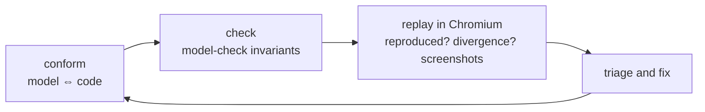

# Behavioral verification

Traditional unit tests typically cover specific sequences someone thought to write. Many of the bugs in React Aria's stateful code sit in sequences not necessarily covered by these tests. The number of possible action orderings grows too fast to enumerate by hand and include in traditional unit tests.

By modeling a component's behavior in a formal specification language like TLA+, we can systematically explore all possible sequences of actions and check that the invariants (i.e. assertions tested at every step) hold, even in edge cases that are difficult to cover with traditional unit tests.

This harness enables agents to write formal specifications of component behavior, check them against the real code, model-check invariants far deeper than the real code can be run, and investigate each violation by replaying it on the real code in Chromium.

- [When to use it](#when-to-use-it)
- [Quick start](#quick-start)
- [Find a bug](#find-a-bug)
- [Read the results](#read-the-results)
- [Common problems](#common-problems)
- [Write a target](#write-a-target)
- [Add a model](#add-a-model)
- [Maintain the harness](#maintain-the-harness)
- [Reference](#reference)

## When to use it

Use the harness to look for bugs in stateful behavior: timers, module-level registries, multiple instances that share state, event ordering, and cleanup on unmount. Use it to check a fix or refactor of that kind of code, too. Choose a target that drives the affected code, and [write a target](#write-a-target) when none does.

It does not check rendering, layout, styling, or performance. Each target covers only its own actions, bounds, and assumptions, which its README lists.

## Quick start

From the repository root, with dependencies already installed:

```sh
# Install Chromium if it is missing. Counterexamples are replayed in it.
yarn playwright install chromium

# List the targets. For one with a model: check the model against the code, then
# model-check it, replaying each counterexample on the real code in Chromium.
yarn verify list
yarn verify conform use-press
yarn verify check use-press --depth 12
```

`check` prints each invariant's status, then for each violation its action sequence, whether it reproduced on the real code in Chromium, where the code first differs from the model, the directory of per-step screenshots, and a `Replay:` command. For a target without a model, use [`explore`](#search-the-real-code-without-a-model). Use `yarn verify --help` or the [command options](#command-options) for everything else.

**A pass is bounded evidence, not proof.** It covers only the target's actions and the depth checked, and holds for the code only as far as the model [conforms](#2-check-the-model-against-the-code). [Check that the target catches a bug](#check-that-it-catches-a-bug) before relying on one.

## Find a bug

The model is the primary way to search: it is fast enough to check every sequence to depths the real code cannot reach. The real code checks the model (`conform`) and confirms each counterexample (`check` replays them in Chromium). Only a counterexample that reproduces on the real code is evidence of a bug.



### 1. Choose a target

Read the target's README for its actions, invariants, and assumptions and exclusions. If the behavior you suspect is excluded, extend the target or write a new one. If the target has no model, [add one](#add-a-model), or [search the real code directly](#search-the-real-code-without-a-model).

| Target | Default environment | Model | Coverage |
| --- | --- | --- | --- |
| [use-press](use-press/README.md) | jsdom | [UsePress.tla](use-press/UsePress.tla) | Two pressables, pointer leave/re-entry, activation and lifecycle. |
| [toast-queue](toast-queue/README.md) | jsdom | [ToastQueue.tla](toast-queue/ToastQueue.tla) | Queue, timers, focus, hover and pause/resume. |
| [focus-scope](focus-scope/README.md) | Chromium | [FocusScope.tla](focus-scope/FocusScope.tla) | Nested scopes, contain/restore/autoFocus modes, focus moves and removal. |
| [drag-manager](drag-manager/README.md) | jsdom | [DragManager.tla](drag-manager/DragManager.tla) | Session, targets, drop/cancel, unregister, source removal and cleanup. |
| [tooltip](tooltip/README.md) | jsdom | None | Two triggers, warmup/cooldown, registry and timer cleanup. |
| [overlays](overlays/README.md) | jsdom | None | Two nested or sibling overlays, Escape ownership, hiding and scroll counts. |
| [combobox](combobox/README.md) | jsdom | None | Typing, selection, blur, controlled updates and async item arrival. |

### 2. Check the model against the code

```sh
yarn verify conform use-press
```

`conform` runs every action sequence of the real code up to the target's depth bound (in its default environment, or `--environment chromium`) and compares it with the model in both directions:

- Each path the code takes must be a behavior of the model with the same `View` at every step. Otherwise it reports the action the model does not allow, or the `View` fields that differ.
- Along those behaviors, the model must allow only actions the code enables. Otherwise it reports the action the model allows too much.

Run it first, and again whenever the source or the model changes. Fix the model until it conforms before trusting `check`: a model that allows too much produces counterexamples that do not reproduce, and one that allows too little misses bugs. When the code's behavior looks wrong, triage it as a possible bug instead.

Beyond the depth bound, conformance is an assumption. The model's hidden state (variables `View` does not determine) is not compared directly.

### 3. Model-check

```sh
yarn verify check use-press --depth 20
```

`check` model-checks each invariant separately, to depth 100 at most, so one violation does not hide the others. It writes each counterexample as a trace, with the model's state and `View` after each step, and then replays every counterexample on the real code in Chromium, in one browser run. Pass `--no-replay` to skip that, for example while iterating on a model.

### 4. Triage each violation

For each violation, `check` prints the replay's result:

| Replay | Meaning | Next step |
| --- | --- | --- |
| `reproduced` | The real code violates the invariant too. | Decide what kind of violation it is (below). |
| `not-reproduced`, with a divergence | The model allows something the code does not. The divergence is the first step where the code's projected observation differs from the model's `View`, with the fields that differ. | Fix the model at that step, run `conform`, and `check` again. Extend the depth of `conform` if it conforms. |
| `different-violation` | Another invariant fails first on the real code. | Triage that one. |
| `disabled` | The code does not enable an action of the counterexample. | The model allows the action where the code does not; fix the model. |

A reproduced violation can still have a divergence, when the model and code reach the failure along different states. Look at the screenshots in `<Invariant>.steps/` (one after setup and one after each action, named `NN-<action>.png`) to see what the code rendered at each step. To watch it happen, replay it headed: a Chromium window opens and pauses after each step.

```sh
yarn verify replay use-press --headed --trace <trace path printed by check>
```

Decide what kind of reproduced violation it is before changing anything:

| Cause | Signs | Next step |
| --- | --- | --- |
| Bug in the code | A user or application can produce the sequence, and the expected behavior follows from documentation or the component's contract. | Fix it with a regression test. |
| Bug in the target | The reference is wrong, a guard allows input that cannot happen, or the observation merged states that differ. | Fix the target (and the model to match), and run `conform` again. |
| Contract question | The code behaves consistently, but the intended behavior is unclear, such as use-press's `OtherClick` or a tooltip cooldown that survives the last unmount. | Record it under the target README's assumptions, and ask a maintainer. |

Don't weaken an invariant or tighten a guard just to make a violation go away. When you change one, say why in the target's README.

### 5. Fix and check again

After a fix, update the model to the fixed behavior, run `conform` until it conforms again, and `check`. A known bug can hide others behind it: once an invariant fails, the shortest counterexample is the only one reported for it.

### 6. Report

Put the confirmed trace (the invariant and its action sequence) in the PR description, with the fix and a regression test in the owning package's `test/` directory. Evidence directories are temporary; don't commit them or add a findings archive here.

### Search the real code without a model

```sh
yarn verify explore tooltip
yarn verify explore tooltip --depth 10 --max-runs 100000
```

`explore` runs every enabled action sequence of the real code breadth-first up to the target's `bounds.depth` (at most 20), checking the target's invariants after each step, so the first trace reported for each invariant is a shortest one. Sequences that reach the same observation are merged. Use it for targets without a model, and for checks that need the real code's internals, such as leaked listeners or timers. Replay its traces in Chromium with `yarn verify replay <target> --trace <file>`.

Before trusting a pass, read the summary:

- `neverEnabled` lists actions that no explored state enabled. Check those guards.
- On a pass, `depthReached` below the depth bound means no unexplored state remained, within what `observe` distinguishes. When it equals the bound, deeper sequences were not tried.
- If the run budget (`--max-runs`) runs out first, the status is `incomplete`, which is not a pass.
- Console errors, such as React warnings, are reported but do not fail the run. Read them in `summary.json`.

Sequences are not extended past a violation, so fix it locally, or temporarily tighten the guard that reaches it, and explore again.

## Read the results

Each run prints its evidence directory, `verification-<target>-<random>` under `--output` or the system temporary directory:

| File | Contents |
| --- | --- |
| `summary.json` | The final result: status, exit code, counts, coverage, violations with their trace paths, and console errors. `--json` prints the same object. |
| `<Invariant>.trace.json` | One per violated invariant, from `explore` or `check`. Pass it to `replay`. |
| `<Invariant>.steps/` | Screenshots of the code under test after setup (`00-setup.png`) and after each action (`NN-<action>.png`), from replays in Chromium. |
| `vitest.log` | Complete Vitest output. Start here when a run reports an error. |
| `result.json` | The result as the Vitest run wrote it, before process failures and trace paths were added. |
| `request.json` | The command's options and, for `replay`, the trace. |
| `replay.*` | `check`'s replay of its counterexamples: the same files for that Vitest run. |

### Exploration summary

| Field | Meaning |
| --- | --- |
| `runs` | Action sequences executed, each from a fresh `setup`. |
| `distinctStates` | Distinct observations reached. |
| `depthReached`, `bounds` | How deep the search went, and the depth and run limits it used. |
| `coverage` | For each action, how many distinct states enabled it and how many runs took it. |
| `neverEnabled`, `neverRan` | Actions that no explored state enabled, and actions that no run took. An action enabled only at the depth bound is enabled but never run. |
| `violations` | For each violated invariant: its message, actions, observations, and trace path. |
| `consoleErrors` | Up to 20 `console.error` calls from the run. |

`check` reports each invariant's status (`passed`, `violated`, or `error`) and distinct model states. Its traces have `origin: "model"`; their `observations` are model states, and `views` holds the model's `View` after setup and after each action. Each violation's `replay` holds the Chromium replay's `status`, `step`, `failures`, `divergence` (the first step where the code's projected observation differs from `views`, with the differing fields, or `null`), and `screenshots` directory. A standalone `replay` of a model trace reports `divergence` too.

`conform` reports the number of traces and steps compared. A mismatch has a `kind`: `action` (the code took an action the model does not allow), `state` (the `View` fields that differ), or `extra` (the model allows an action the code does not enable), with the action sequence that leads to it.

### Statuses and exit codes

| Command | Exit 0 | Exit 1 | Exit 2 |
| --- | --- | --- | --- |
| `explore` | `passed` | `violations` | `incomplete`, `error`, `timed-out`, `interrupted` |
| `check` | `passed` | `violations` | `error`, `timed-out`, `interrupted` |
| `conform` | `conforms` | `mismatch` | `incomplete` (exploration ran out of runs), `error`, `timed-out`, `interrupted` |
| `replay` | `not-reproduced` | `reproduced` | `different-violation`, `disabled` (an action is no longer enabled), `error`, `timed-out`, `interrupted` |

`check`'s exit code reflects the model check only; read each violation's replay status to see whether it reproduced. Invalid arguments also exit 2.

## Common problems

| Problem | Next step |
| --- | --- |
| `Nondeterministic target: replaying a prefix produced a different observation.` | State leaked between runs, or the observation includes something that varies between runs. Compare `expected` and `actual` in `summary.json`, reset every global the code keeps in `setup`, and use fake timers. |
| `Action <name> was enabled during search but not on replay.` | The guard depends on state that differs between runs with the same observation. Make guards read only state that `observe` includes. |
| `Missing verification probe: <suffix>` | No module matching the suffix was instrumented. Check the suffix in [instrumentation.ts](instrumentation.ts), and import the code under test from package source. |
| `Run evidence must be outside the checkout.` | Pass an `--output` directory outside the repository, or omit it. |
| `Vitest did not produce a result.` | The target failed to compile or import, or Vitest failed to start. Read `vitest.log`. |
| `Playwright input never reached the page.` or `Input not registered: …` | Chromium input missed the element. Check that it is laid out, visible, and not covered in the 1280×720 viewport. If Chromium is missing, run `yarn playwright install chromium`. |
| `incomplete` | The run budget ran out. Raise `--max-runs`, lower `--depth`, tighten guards that allow redundant input, or use a model. `conform` needs a complete exploration. |
| `TLA+ values must be integers`, `TLA+ has no empty record`, `Invalid field`, or `Cannot express … in TLA+` | `model.project` or `model.constants` produced a value TLA+ cannot represent. Use booleans, integers, strings, arrays, and non-empty objects with identifier keys; no `null`, `undefined`, or fractions. |
| `conform` reports a mismatch | The model no longer matches the code. Fix the model and run `conform` again. If the code's behavior looks wrong, triage it as a possible bug. |
| A model counterexample is `not-reproduced` | The model allows something the code does not, beyond the depth `conform` explored or in hidden state the `View` does not show. Fix the model at the step its divergence names, and consider adding the hidden state to the `View`. |
| `different-violation` on replay | Another invariant fails first. Triage that one. |
| `disabled` on replay | The trace is stale: the code or the target's guards changed since it was written. Explore or check again. |

## Write a target

1. Create `verification/<name>/target.tsx`, where `<name>` is kebab-case, exporting `defineTarget({...})` from [explorer.mjs](explorer.mjs). Start from [tooltip](tooltip/target.tsx), the smallest target, or [toast-queue](toast-queue/target.tsx) for components with a model.
2. Import the code under test from package source by relative path (`../../packages/...`), so the target runs this checkout's code and [probes](#probes) apply.
3. Write `verification/<name>/README.md`, following [the target README sections](#target-readme).
4. Add the target to the [targets table](#1-choose-a-target).
5. Run `yarn verify explore <name>`, check `neverEnabled`, and [check that it catches a bug](#check-that-it-catches-a-bug). Then [add a model](#add-a-model) to search deeper.
6. Run `yarn lint`.

### Target fields

- `name`, `description`, and `sources` are required: the directory name, one sentence on what the target drives, and the repository paths of the code under test.
- `setup(env)` and `teardown(ctx)` create and dispose one fresh instance. Reset any global state the code under test keeps (focus, pointer position, interaction modality, module-level registries), because runs share a page.
- `actions` maps names to `run(ctx)`, or `{enabled(ctx), run(ctx)}`; an action without `enabled` is always enabled. Guards describe the input protocol and bound the search. Real input goes through `env.input` (`hover`, `touch`), which is synthetic in jsdom and browser-generated in Chromium.
- `observe(ctx)` returns JSON. Sequences that reach the same observation are merged, so include everything that affects future behavior, including real internals such as pending timers and listeners. Merging unequal states can hide bugs. When the code keeps state you cannot read (such as a hook's refs), add a stand-in from the run's history; toast-queue's `focusEntered` and use-press's `fallbackClicked` are examples.
- `check(ctx)` (optional) throws when the environment did not do what the actions intended, such as real input that did not register. That makes the run an error rather than evidence.
- `invariants` return `true`, or `false`/a message when violated. Compare real behavior against a reference computed from the inputs. Never set a flag where you expect the bug: an invariant that reads it only restates your guess.
- `bounds` sets the default `depth` and an optional `maxRuns` (20,000 when omitted).
- `model` (optional) is described in [Add a model](#add-a-model).

Each run calls `setup`, then `check`, the invariants, and `observe`, and after each action, `check`, the invariants, and `observe` again. Once `setup` succeeds, `teardown` runs last, even when something else failed. A target can add `target.json` with `{"environment": "chromium"}` to explore and conform in Chromium by default.

### Helpers

| Helper | Use |
| --- | --- |
| `probe(suffix)` | Returns a [probe](#probes); throws if the module was not instrumented. |
| `tick(ms)` | Advances fake timers inside `act`. |
| `trackTimers()` | Wraps `setTimeout` and `clearTimeout`, so `pending()` returns how long each timer has left. Install it after `vi.useFakeTimers()` and call `restore()` in teardown. |
| `trackListeners()` | Records `document` and `window` listeners for `read()`. `restore()` removes leftover listeners and the wrappers. |
| `cleanup(...steps)` | Runs every teardown step even when an earlier one throws. |

`cleanup` is in [runtime.mjs](runtime.mjs); the others are in [helpers.ts](helpers.ts).

### Probes

[instrumentation.ts](instrumentation.ts) appends a probe to a package module, matched by a path suffix such as `/tooltip/useTooltipTriggerState.ts`, only in verification builds. The probe is evaluated inside the module, so it can read and reset module-level variables without changing production modules or public exports. Reset probe state in `setup`, and again in `teardown`, which runs after the invariants are checked, so a leak can neither carry into the next run nor disappear before it is checked.

### Check that it catches a bug

Before trusting a pass, plant a bug the target should find: revert a past fix, skip a cleanup, or remove a condition in the source. Confirm that `explore` reports the expected invariant with a short trace, then restore the source. For a model, also confirm that `conform` reports a mismatch with the planted bug, then make the same change in the model and confirm that `check` reports a counterexample that reproduces in Chromium. If it does not, the observation may be merging states, a guard may be too tight, or the invariant may restate the implementation.

### Target README

Follow [use-press](use-press/README.md) and [toast-queue](toast-queue/README.md):

- The commands to run.
- **Actions and bounds**: each action's effect and guards, and the default depth, with its run count and duration when it is slow.
- **Reference model and invariants**: the expected behavior, and a table of each invariant's contract.
- **Model**: what the model abstracts and any known deviations from the code, when there is one.
- **Assumptions and exclusions**: what the target does not cover, and open questions about the contract.

## Add a model

Add a model when the real code is too slow or its state space too large to run through, or to reason about a design before it is built. `check` checks invariants only, not temporal properties. Set `model` in the target and put the `.tla` file beside it:

```ts
model: {
  spec: 'UsePress.tla',
  // The observation, in the model's View vocabulary.
  project: ({timers, listeners, ...rest}) => ({...rest, timer: timers > 0, listeners: listeners.length > 0})
}
```

| Field | Purpose |
| --- | --- |
| `spec` | The `.tla` file, relative to the target's directory. Modules it extends are loaded from the same directory. |
| `project(observation)` | Maps an observation to the model's `View` record. Use only values that TLA+ can represent: booleans, integers, strings, arrays, and non-empty objects with identifier keys. |
| `constants` | Extra `CONSTANT` values, as JSON. |
| `depth` | The default `check` depth; `bounds.depth` when omitted. |
| `invariants` | The target invariants to model-check; all of them when omitted. |

The model must declare:

- `CONSTANT MaxSteps`.
- Variables including `action` and `step`, all listed in `vars`.
- `Init`, with `step = 0`.
- A `Next` that requires `step < MaxSteps`, increments `step`, and sets `action'` to the name of the target action each transition corresponds to.
- A `View` record with the same fields as `project` returns.
- One operator per checked invariant, with the same name as the target's invariant.

`conform` and `check` wrap the model in modules that extend it. `conform`'s extends `Integers`, `Sequences`, and `TLC` and defines `trace`, `Traces`, `Views`, `Limit`, `Expected`, `Differs`, `Unreached`, `AllReached`, `modelView`, `differs`, and names starting with `Conform`. `check`'s defines `verifyView` and names starting with `Verify`. A model must not define those names.

`conform` explores the real code in the target's default environment (or `--environment chromium`) with invariants off, recording the actions the code enables after each step, then follows every explored run through the model, comparing `View` with the projected observation after each step. The model may be nondeterministic: a run conforms when some behavior of the model takes its actions with a matching `View` at every step. Along those behaviors, the model must not allow an action the code did not enable. Within the explored depth, the model then has the code's behaviors and no others, as far as the `View` shows. A model that allows too much in hidden state, or beyond that depth, still conforms; its counterexamples then do not reproduce, and their divergence shows where the model goes wrong.

`conform` also cannot catch an observation that leaves something out: once two states are merged, the second one's successors are never run. A model that tracks state the code hides shows what the observation needs to distinguish.

`check` model-checks each invariant separately, so one violation does not hide the others. The model's state includes `step`, so its distinct-state count grows with depth even after the other variables have reached every value they can.

The target's JavaScript invariants are still required for a model's invariants: they decide whether a counterexample reproduces on the real code, where the model's variables are not available.

## Maintain the harness

After changing harness code, run:

```sh
yarn test:verification
yarn lint
```

The harness tests cover the explorer, model checking, conformance, and CLI with toy targets and models, and need no browser. `yarn lint` format-checks, type-checks, and lints this directory along with the packages.

After changing a target, a model, or the package source a target drives, run `yarn verify conform <target>` and `yarn verify check <target>` (or `explore` for a target without a model) and inspect the results. A model that no longer conforms must be updated before its `check` results are trusted.

## Reference

### Command options

| Option | Commands | Default |
| --- | --- | --- |
| `--depth <n>` | `explore` and `conform` (at most 20), `check` (at most 100) | `bounds.depth`; `model.depth` for `check` |
| `--max-runs <n>` | `explore`, `conform` | `bounds.maxRuns`, or 20,000 |
| `--environment <name>` (`jsdom` or `chromium`) | `explore`, `conform`, `replay` | The target's `target.json`, or jsdom; Chromium for `replay`. `check` runs only in jsdom. |
| `--trace <file>` | `replay` | Required; at most 1 MiB. |
| `--no-replay` | `check` | Replays counterexamples in Chromium unless set. |
| `--headed` | `replay` in Chromium | Headless. Shows the browser and pauses one second after each step. |
| `--timeout-ms <ms>` | All except `list` | 600,000 (10 minutes); at most 3,600,000. |
| `--output <directory>` | All except `list` | The system temporary directory. Must be outside the checkout. |
| `--json` | All | Prints the result as JSON. |

### How runs work

All commands run inside Vitest ([targets.config.ts](targets.config.ts) and [targets.runner.tsx](targets.runner.tsx)), which supplies TypeScript, the repository's module resolution, jsdom or Chromium, and fake timers. Model checking always runs in Node; `check` then starts a second Vitest run in Chromium that replays all of its counterexamples. Chromium conformance explores in the browser and sends projected observations to a Vitest server command, so `tla-ts` and model files stay in Node. Screenshots are taken by another server command, of the test iframe only.

Each candidate sequence replays its prefix from a fresh `setup`, because real code cannot be snapshotted. The explorer reports an error if a replayed prefix's observation changes, if an action that was enabled during search is not enabled on replay, or if setup, an action, `check`, `observe`, an invariant, or teardown throws.

In jsdom, `env.input` uses user-event for hover and dispatches `PointerEvent`s for touches. In Chromium, the runner first waits for Playwright input to reach the page; hover then uses Playwright, and touches use CDP, so the browser generates the events.

`--timeout-ms` is a cooperative deadline, checked between steps; cleanup runs before a timeout is reported. The parent process stops the run 60 seconds after the deadline, for actions or model checks that hang.
